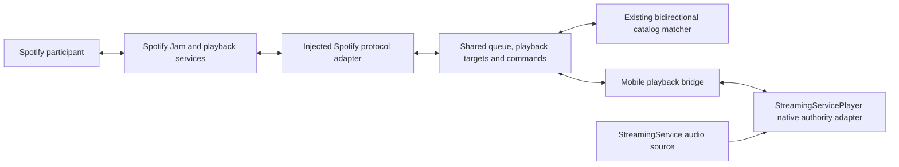

# Playing together: proposed implementation plan

Prepared 2026-10-22 after protocol investigation and independent agent review.
This is a plan for approval. No production synchronization changes were made.
The project streaming-service-quality skill applies to all contracts, code,
native integrations, examples, tests and chapter documentation.

The target is a StreamingService user playing their own catalog through the
existing player while another user listens through Spotify. Both can queue
matched songs and use permitted shared controls. Spotify Jam supplies accepted
shared state; the app supplies its own playable audio. Neither audio delivery
nor synchronization follows automatically from mapping recording IDs.

The evidence supports a design, but independent remote Jam playback is not yet
proven. [Protocol findings](PLAYBACK_PROTOCOL_RESEARCH.md) record what worked and
what remains unknown. The first chapter below must establish fresh cross-account
delivery before a production bridge is treated as viable.

## Proposed ownership

The Spotify library owns session observation, shared queue occurrences, accepted
playback anchors, permissions, command reconciliation and timing estimation.
Focused injected interfaces keep it independent of React Native and the player.
The mobile app owns composition, catalog/media resolution and joining/leaving
the shared playback mode. The player owns native execution, system controls and
accurate local position/readiness samples. Application and Spotify credentials
remain separate.

## Chapter 1: prove remote participation and fresh state

Use two controlled accounts/devices, first with official Spotify clients, then
replace one observation path with the independent probe. Capture both host roles.

- Validate invitation resolution, join/leave, remote-listening versus control-only
  admission, required device registration and resulting permissions.
- Trace host track changes, repeated tracks, pause/resume, seek, skip and queue
  edits to actual Dealer/native messages. Compare network state with the official
  guest, preserving exact event envelopes and timestamp domains in sanitized
  fixtures. Membership notifications alone do not pass this gate.
- Prove bootstrap and continuous fresh playback delivery to the independent
  connection, including session identity, host/device association and reconnect.
  The current HTTP observer returned stale account state and does not pass.
- Establish command addressing, acknowledgements, queue revisions, conflict
  behavior and unknown-outcome recovery. Classify any routes found only as binary
  strings as candidates until a controlled request succeeds.
- Prove credential acquisition/renewal independently of desktop debugging and
  test endpoint eligibility. Existing desktop-derived tokens prove transport
  access only. Keep any temporary companion arrangement explicit and research-only.

Exit evidence: two-account captures, independent fresh state and recovery,
documented permission/ordering rules, cleanup, and a concrete capability matrix.
If the service requires an unimplemented listener protocol, continue that research
and revise the design before promising a usable follower.

## Chapter 2: protocol observation and commands

Extend the library with separate session, playback-observation and command
interfaces. Implement an injected reconnecting push transport and bounded wire
decoders from the verified fixtures. Do not expose native Esperanto as a public
network API or hardcode regional hosts.

Shared snapshots should retain queue occurrence identity separately from recording
identity, accepted playback identity, source timing domain, pause/buffering state,
permissions, freshness, authority and connection generation. Preserve remote
ordering fields actually supplied. Local counters fence stale work but do not
invent remote revisions or global ordering.

Use an initial snapshot plus updates and explicit resnapshot after a gap. Reject
wrong-session/device/account events and superseded anchors. Treat disconnected or
stale observations as unsynchronized. Pending edits settle through verified acknowledgements
or authoritative observation; an HTTP response alone must not invent a queue
revision. Never blindly retry non-idempotent add/skip operations.

Assess observation freshness through current authenticated snapshots, matching
session/authority identity, verified ordering and reconnect state. Keep that
separate from anchor age: a correctly correlated paused playback anchor can
legitimately remain old. Interpret its age according to whether playback advances.

Exit tests: decoding boundaries, sparse/malformed protobuf or JSON, duplicate and
out-of-order updates, missed events, resnapshot, bounded retention, cancellation,
credential renewal, session/account replacement, permission denial and uncertain
command reconciliation. Each behavior gets dedicated tests in FEATURES.md.

## Chapter 3: controlled local follower

Begin with Spotify supplying the accepted playback target and the app following
through its own media source. Then add app-originated shared controls. This is an
implementation order; the final scope includes both directions.

Add an explicit external-authority mode to the player/mobile boundary:

- Suppress app-generated continuation and independent native advance, shuffle or
  repeat decisions. Maintain unavailable entries in the shared queue. Holding a
  single current native item is a possible first milestone, with explicit held-end
  behavior; it does not establish seamless transitions.
- Route app, lock-screen, headset and car control intents through the shared
  permission policy. Native controls currently bypass React UI handlers.
- Separate user intents from execution of remote targets, drift corrections and
  local interruption pauses. Reflected playback must never generate an echo
  command back into the Jam.
- Resolve and prepare a recording paused. Recheck account, session, playback,
  queue and authority generations after every asynchronous step. Apply the latest
  position after preparation rather than an old lookup-time target.
- Observe actual readiness and seek completion. Extend native contracts where
  necessary; current command acceptance is not proof of audible start. If required
  by measurements, provide guarded prepare/seek/start with a monotonic deadline.
- On detach/logout/session end, retire transport and preparation, restore normal
  rate and release authority. Default to paused local output; resuming the previous
  local queue should be an explicit user action, not an accidental transition.

Exit tests: no independent suggestions/advance, paused preparation, stale source
resolution and commits, readiness, seek completion, duplicate occurrences,
missing/unseekable media, interruptions, native/system controls, source release,
account changes and remote-command echo prevention.

## Chapter 4: clock mapping and audible synchronization

Represent an accepted playback anchor with its verified clock domain and local
monotonic receipt/sample times. Estimate clock mapping and uncertainty; do not
subtract Spotify wall time from native uptime. Extrapolate only when the verified
state says playback is advancing. Pause/buffering and stale state require explicit
handling. A fresh HTTP server timestamp does not make an old track anchor fresh.

Start with a measured deadband and guarded seek correction. Evaluate temporary
rate correction only if it improves measured behavior. Inject policy for sample
age, drift tolerance, hard-seek threshold, correction cooldown and rate bounds;
choose values from experiments rather than inventing synchronization guarantees.
Reset corrections on track change, pause, detach and failure.

Recording identity and timeline alignment are separate. The existing matcher's
duration tolerance is not a synchronization tolerance. Different leading silence,
mastering or edits may require a measured per-recording offset with its own
provenance and invalidation. Do not fit different versions by duration ratio.

Exit evidence: controlled two-output audio measurement, median/tail offset,
transition offset and recovery time across network delay, buffering, clock
changes and interruptions. Agreeing progress bars and passing host tests do not
prove synchronized audio. Define acceptable product limits from these results.

## Chapter 5: both queue directions and shared controls

For an app-originated queue addition:

1. Translate the local recording into a playable Spotify identity for the market.
2. Require a selection for ambiguous matches; report unshareable recordings.
3. Submit one permitted queue intent and show it as pending.
4. Accept the authoritative queue occurrence and reflect it on both sides.
5. Start the local audio only when accepted playback reaches that occurrence.

For a Spotify-originated queue addition:

1. Receive the authoritative queue update and retain its occurrence identity.
2. Translate the Spotify track into the local catalog without changing shared order.
3. Prepare available media before its turn, with cancellation and generation guards.
4. Follow accepted playback timing when that occurrence becomes current.
5. If no usable exact recording exists, show it as unavailable and pause/mute this
   device for that slot while continuing observation. Do not skip the whole Jam
   to satisfy one device or silently substitute a different recording.

App pause/seek/skip intents pass through permissions and verified service ordering,
then reconcile through authoritative targets. Simultaneous local/remote actions,
duplicate commands and lost responses need explicit pending/conflict results.
Queue-only participants must not obtain playback controls by using our bridge.

Exit tests: both translation directions, ambiguous/missing tracks, repeated songs,
queue revisions, denied controls, concurrent edits and skip/seek, command echoes,
uncertain outcomes and changed host/permissions.

## Chapter 6: hosting and platform delivery

Validate Spotify-hosted and app-hosted sessions separately. Existing Jam creation
does not prove the independent player can lead the shared playback clock. Prove
listener registration, host command redirection, host replacement and simultaneous
audio before declaring app hosting supported. An exclusive Connect transfer is
not equivalent to remote listening.

For Android and iOS, establish native ownership while JavaScript is suspended,
credential renewal, network reconnection, system controls and interrupted audio.
Keep local history/Last.fm reporting asynchronous and account-scoped. Host
compilation, JavaScript bundles, native packages, physical-device scenarios and
measured audio alignment remain separate validation gates.

Commit completed chapters in the library/player/mobile/server repository that
owns each change. Keep progress notes, feature mappings and exact validation
commands current. No push, engine migration or production implementation is
authorized by this research plan alone.

## Immediate next action after approval

Run Chapter 1 with a second controlled account/device. This is the missing evidence
for remote playback admission and freshness. In parallel with any independent
research, contracts can be drafted for review, but they must not claim remote
listening or precise synchronization until those gates pass.
